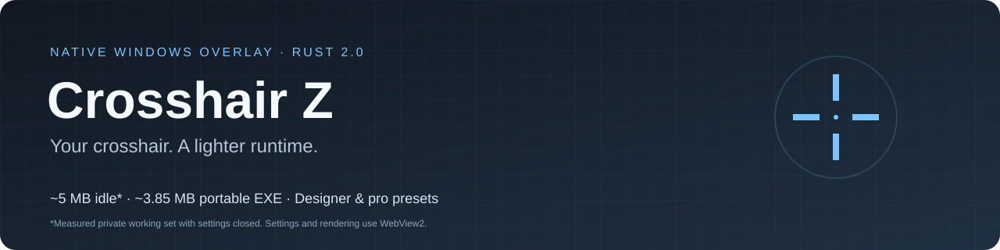
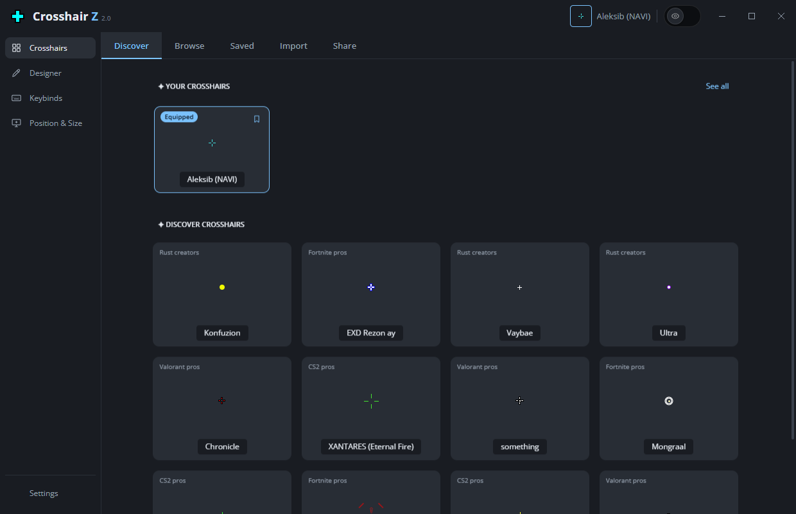
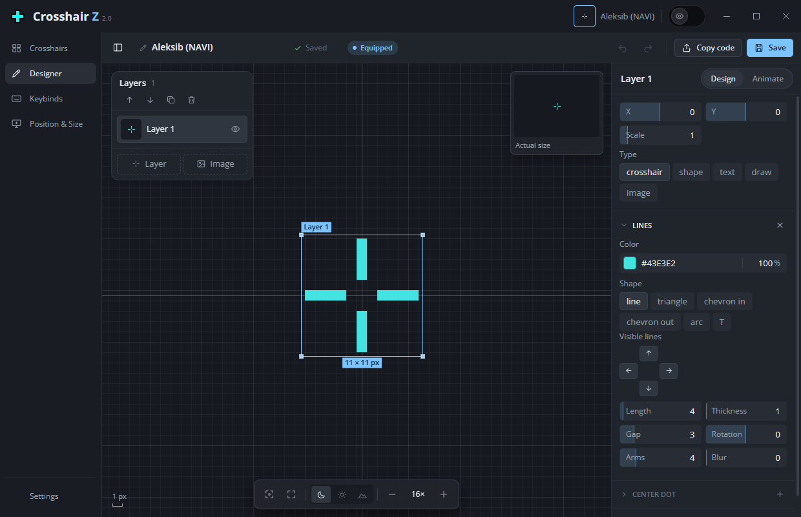
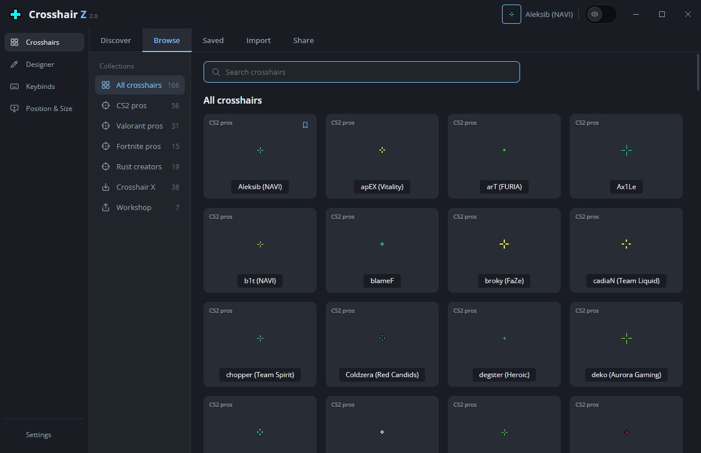
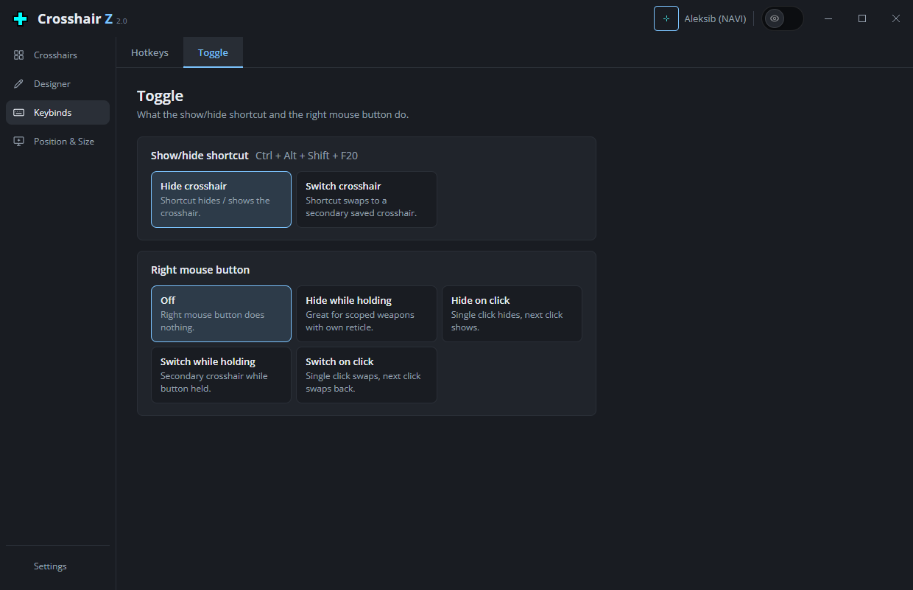

<p align="center">
  
</p>

<p align="center">
  <a href="https://github.com/Nn1ff/crosshair-z/releases/latest"></a>
  
  
  
</p>

**Crosshair Z** puts a custom crosshair on top of your game. Choose a pro player's crosshair, design your own pixel by pixel, and switch crosshairs with a hotkey or the right mouse button. It is a single portable exe: no installer, no account, and it does not touch the game.

## Download

**Version 2.0 uses Rust with a native Windows overlay.** Microsoft Edge WebView2 Runtime
is required for settings and generating crosshairs; it is already installed on many Windows PCs.
The settings window releases its browser processes when closed. See the
[native build and testing guide](native/README.md) for requirements and validation coverage.

1. Get **`Crosshair-Z.exe`** from the [latest release](https://github.com/Nn1ff/crosshair-z/releases/latest).
2. Run it. You don't need to install anything.
3. Pick a crosshair and play. Run the game in **borderless** or **windowed** mode (exclusive fullscreen hides overlays).

> Windows may warn because the exe is not signed: **More info → Run anyway**.

## Screenshots

Captured from the native 2.0 settings window with isolated sample data.

<table>
  <tr>
    <td width="50%"></td>
    <td width="50%"></td>
  </tr>
  <tr>
    <td align="center"><b>Discover</b>: your crosshairs plus a fresh mix of pro picks</td>
    <td align="center"><b>Designer</b>: layers on a pixel grid, previewed against a game scene</td>
  </tr>
  <tr>
    <td width="50%"></td>
    <td width="50%"></td>
  </tr>
  <tr>
    <td align="center"><b>Browse</b>: 120+ pro / creator crosshairs by game</td>
    <td align="center"><b>Toggle</b>: hide or switch on hotkey or right-click (great for scopes)</td>
  </tr>
</table>

## Features

**Crosshairs**
- 120+ crosshairs from CS2, Valorant, Fortnite and Rust pros and creators, plus a built-in library
- Discover page with your saved crosshairs and a new random mix on every visit
- Bookmark crosshairs to Saved; each one can have its own hotkey
- Share codes (`CZ3-…`) to swap designs with friends; older `CZ1`/`CZ2` codes still work
- Imports the crosshairs you saved in Crosshair X / Y, including layered designs

**Designer**
- Layers: **crosshair** (lines + center dot), **shape** (square, circle, triangle), **text** (straight or around a circle), **pixel drawing** and **image**
- Line styles: classic, triangle, chevron in/out, arc, T-cap, and 3–8 arms around the center
- Separate color, opacity and blur for lines, dot and outline. Pixel-crisp gaps for odd and even line widths
- Optional firing animation (spread and kick while the left mouse button is held)
- Undo/redo, drag-to-move, scrubbable fields, actual-size preview on dark, light or game backgrounds

**In game**
- Click-through overlay that stays on top of borderless and windowed games
- Show/hide or switch crosshairs with a hotkey or the right mouse button (hold or click)
- Choose the monitor, nudge the position pixel by pixel, scale the whole crosshair

## Lightweight by design

| | |
|---|---|
| **CPU** | ~0% while idle: the overlay only redraws when something changes |
| **RAM** | ~5 MB private working set measured with settings closed; opening settings also starts WebView2 processes |
| **Privacy** | No account, telemetry or ads. One optional update check against GitHub (can be turned off) |
| **Anti-cheat** | A plain transparent window above the game: no DLL injection, no hooks, no memory reading |
| **Footprint** | ~3.85 MB portable Rust exe; WebView2 Runtime for settings/rendering; no background services |

## Updating

When a new version is out, Settings shows **Update**. Crosshair Z downloads the new exe next to the current one, switches over automatically and removes the old copy. Autostart (if enabled) follows the new version, so you never end up with two entries.

## FAQ

**The crosshair doesn't show in game.** Switch the game to borderless/windowed fullscreen. Exclusive fullscreen draws over every overlay.

**Is this safe with anti-cheat?** Crosshair Z never touches the game process. It is an ordinary always-on-top window, like Discord's or Steam's overlay.

**Can I use my Crosshair X crosshairs?** Yes. Saved and Workshop crosshairs from your local Crosshair X data show up under **Browse → Crosshair X**.

**Do I need the Edge browser?** You need Microsoft Edge WebView2 Runtime for the settings
and designer, but you do not need to open the Edge browser. Windows may list these child
processes as WebView2 Manager. They are part of the app's memory usage while settings are open.

**Will my old settings work?** Version 2.0 reads the same config as 1.8.x. After upgrading,
re-select your monitor if you used a secondary display: the native display IDs differ.

## Development

Build the current native release from the repository root:

```powershell
npm ci
powershell -NoProfile -ExecutionPolicy Bypass -File native/app/scripts/package.ps1
node scripts/capture-native.js  # refresh README screenshots using the native app
```

The package script runs tests, builds the Rust runtime and checks the live overlay.
The result is `release-native/Crosshair-Z.exe`. See [native/README.md](native/README.md)
for toolchain requirements, isolated testing and migration details.

```powershell
npm start           # run the native Rust app (cargo must be on PATH)
npm test            # shared JavaScript engine, import and sprite codec tests
npm run dist        # test and package the native portable exe
npm run export:native # refresh generated Rust defaults after shared-engine changes
npm run build:pack  # rebuild the bundled pro crosshair pack from its source data
```

Dev aids:
- `node scripts/capture-native.js` refreshes the screenshots from the real native settings UI
- `CZ_USERDATA=<dir>` uses isolated config and instance endpoints, skipping system integration

<details>
<summary>Project layout</summary>

```
native/app/     Current Rust runtime: native overlay, config, input, updater, tray and settings IPC
src/native/     WebView2 bridge and sprite rendering/transport
src/renderer/   Settings UI and designer
src/shared/     Crosshair engine (schema, rendering, share codes), Crosshair X/Y import, preset pack
test/           Unit tests
```
</details>

## Notes & credits

- Crosshair X is a separate product. Crosshair Z only reads crosshair data you saved locally and contains no Crosshair X code or assets.
- Open Sans font: SIL Open Font License 1.1 (`src/renderer/fonts/OFL-LICENSE.txt`)
- Settings gear icon: [Font Awesome Free](https://fontawesome.com) "gear", CC BY 4.0 ([license](https://fontawesome.com/license/free))
